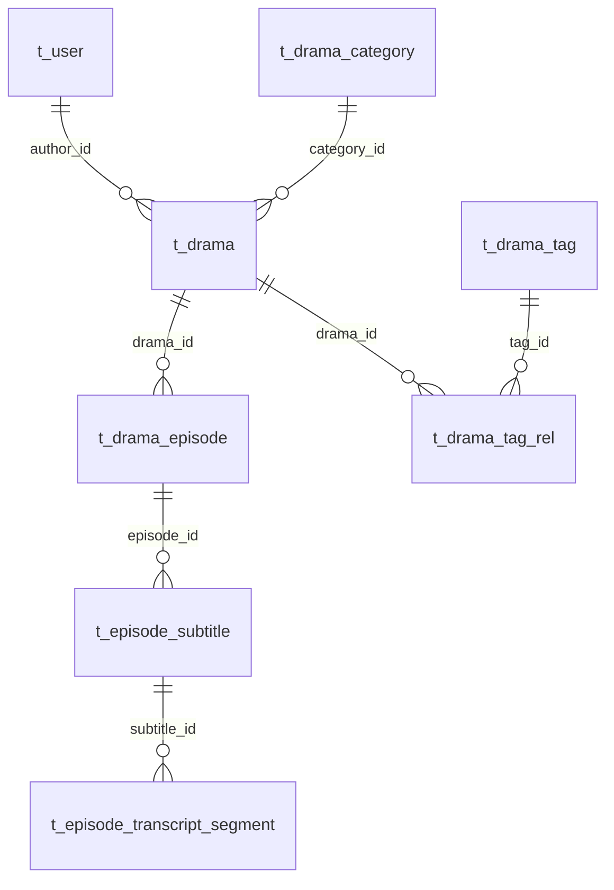
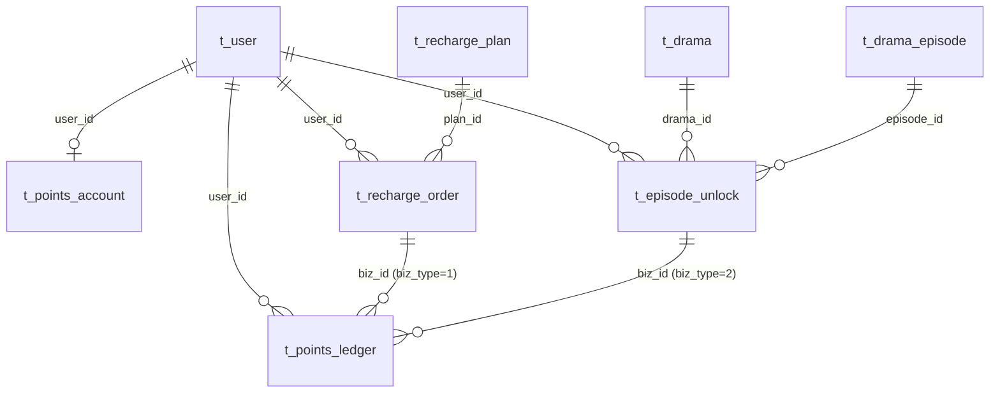
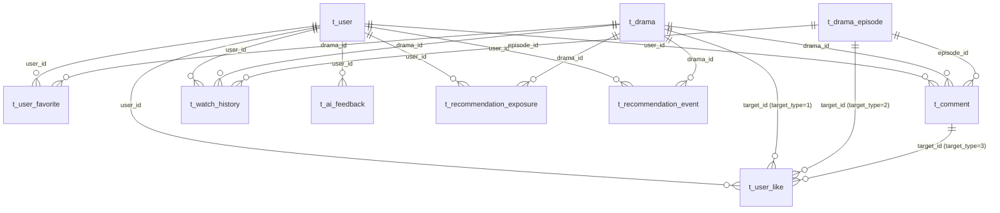

# 业务表结构

单库 `DL`，22 张核心表 + 一致性辅助表（`undo_log`、`t_episode_unlock_ref`、`t_event_consume_log`），按用户、短剧、订单/积分、互动四个域划分。表前缀用于后续按服务拆分：`t_user_*`、`t_drama_*`、`t_episode_subtitle` / `t_episode_transcript_segment`、`t_recharge_*` / `t_points_*` / `t_episode_unlock`、`t_user_like` / `t_user_favorite` / `t_comment` / `t_watch_history` / `t_ai_feedback` / `t_recommendation_exposure` / `t_recommendation_event` / `t_outbox_event`。

## 1. 约定

| 项 | 约定 |
|---|---|
| 引擎/字符集 | InnoDB，`utf8mb4`，`utf8mb4_0900_ai_ci` |
| 主键 | `BIGINT UNSIGNED AUTO_INCREMENT`，应用侧映射 `IdType.AUTO` |
| 时间 | `DATETIME(3)`；`create_time` / `update_time` 自动维护 |
| 金额 | `BIGINT UNSIGNED`，单位：分 |
| 积分 | `BIGINT`，流水允许负数 |
| 枚举 | `TINYINT UNSIGNED`，取值见第 4 节 |
| 外键 | 不建外键，关联 ID 由应用层校验 |
| 逻辑删除 | 仅 `t_drama` 使用 `deleted`；用户用 `status`，评论用 `status`，互动关系物理删除 |
| 缓存计数 | 冗余在短剧/剧集/评论行上，互动反馈由 Kafka 消费者异步更新 |

## 2. ER 概览

### 用户与短剧



### 订单与积分



### 互动



## 3. 表清单

| 表 | 域 | 用途 |
|---|---|---|
| `t_user` | 用户 | 手机号、BCrypt 密码、角色、状态 |
| `t_drama_category` | 短剧 | 主分类 |
| `t_drama_tag` | 短剧 | 标签字典 |
| `t_drama_tag_rel` | 短剧 | 短剧与标签多对多 |
| `t_drama` | 短剧 | 短剧主表、审核状态、AI 审核结果、冗余计数 |
| `t_drama_episode` | 短剧 | 分集、视频地址、解锁价格、播放计数 |
| `t_episode_subtitle` | 短剧 | 分集字幕元数据：语言、格式、来源、片段数 |
| `t_episode_transcript_segment` | 短剧 | 带毫秒时间轴的字幕片段，供剧情问答和 seek |
| `t_drama_review_log` | 短剧 | 提交/通过/驳回/下架/AI 审核操作日志 |
| `t_recharge_plan` | 订单/积分 | 充值档位 |
| `t_recharge_order` | 订单/积分 | 充值订单 |
| `t_points_account` | 订单/积分 | 积分账户（1:1 用户） |
| `t_points_ledger` | 订单/积分 | 积分流水（只增不改） |
| `t_episode_unlock` | 订单/积分 | 剧集解锁权益（只增不改） |
| `t_episode_unlock_ref` | 订单/积分 | drama 侧解锁计数幂等引用（`unlock_id` 唯一） |
| `t_user_like` | 互动 | 点赞短剧/剧集/评论 |
| `t_user_favorite` | 互动 | 收藏短剧 |
| `t_comment` | 互动 | 两级评论（根评论 + 回复），含 AI 预审 advisory 列 |
| `t_watch_history` | 互动 | 观看进度（用户 + 剧集唯一） |
| `t_ai_feedback` | 互动 | AI 回答赞/踩反馈，`(user_id, scene, request_id)` 幂等；场景含 `CREATOR_COPY`，用于统计 Copilot 采纳率 |
| `t_recommendation_exposure` | 互动 | 推荐曝光归因，`(request_id, drama_id)` 幂等 |
| `t_recommendation_event` | 互动 | 点击/播放/完播/负反馈事件，四元组幂等 |
| `t_outbox_event` | 互动/集成 | 事务性发件箱，可靠投递 Kafka 事件 |
| `t_event_consume_log` | 互动/集成 | Kafka 消费幂等日志 |
| `undo_log` | 一致性 | Seata AT 分支回滚日志 |

## 4. 枚举字典

| 字段 | 值 |
|---|---|
| `t_user.role` | 0 普通用户，1 创作者，2 管理员 |
| `t_user.status` | 0 禁用，1 正常 |
| `t_drama.review_status` | 0 草稿，1 审核中，2 已上架，3 驳回，4 下架 |
| `t_drama.ai_review_status` | 0 未提交，1 待审核，2 通过，3 驳回，4 失败 |
| `t_drama_episode.status` | 0 下线，1 上线 |
| `t_episode_subtitle.status` | 0 隐藏，1 可用 |
| `t_episode_subtitle.source` | UPLOAD 人工上传，ASR 语音转写 |
| `t_episode_subtitle.format` | SRT / VTT / ASR |
| `t_episode_transcript_segment.status` | 0 隐藏，1 可用；只索引 status=1 且字幕 status=1 的片段 |
| `t_recharge_plan.status` | 0 下架，1 上架 |
| `t_recharge_order.status` | 0 待支付，1 已支付，2 已取消，3 已过期 |
| `t_recharge_order.pay_channel` | 1 MOCK，2 微信，3 支付宝 |
| `t_points_ledger.change_type` | 1 充值，2 解锁，3 人工调整 |
| `t_points_ledger.biz_type` | 1 订单，2 剧集解锁，3 人工 |
| `t_user_like.target_type` | 1 短剧，2 剧集，3 评论 |
| `t_comment.status` | 0 待审，1 可见，2 隐藏，3 已删除 |
| `t_comment.ai_review_status` | 0 未审核，1 审核中，2 通过，3 风险，4 失败 |
| `t_recommendation_event.event_type` | 1 点击，2 播放，3 完播，4 不感兴趣 |
| `t_outbox_event.status` | 0 待发送，1 已发送，2 死信 |
| `t_outbox_event.event_type` | LIKE、UNLIKE、FAVORITE、UNFAVORITE、COMMENT、COMMENT_DELETED、HISTORY、DRAMA_CHANGED、AI_REVIEW_REQUEST |
| `t_outbox_event.aggregate_type` | DRAMA、EPISODE、COMMENT、ORDER |

## 5. 一致性规则

### 5.1 积分

**不变量**：`t_points_account.balance == SUM(t_points_ledger.change_points)`。

- 流水是权威账本，账户余额是快速校验的聚合。
- 解锁使用 **Seata AT 全局事务**：order 本地事务（锁账户 → 检查未解锁 → 校验余额 → 插入解锁 → 扣减余额 → 插入流水）+ drama 本地事务（插入 `t_episode_unlock_ref` → `t_drama_episode.unlock_count + 1`）。
- 任一步失败由 Seata TC 按两个库的 `undo_log` 回滚；order 和 drama 当前都在 `DL` 库，属于服务级全局事务，不是物理分库。
- 流水幂等键：充值 `order:{orderId}`，解锁 `unlock:{userId}:{episodeId}`，人工 `admin:{uuid}`。
- 免费集（`price_points=0`）不写解锁记录，也不写流水。
- 充值走 order 本地事务，不需要 Seata：锁定订单 -> 条件 `status=0 -> 1` -> 确保积分账户存在 -> 锁定账户 -> 加余额 -> 写 `order:{orderId}` 流水。重复支付按幂等返回，不再加积分。

### 5.2 订单

- 支付回调：`UPDATE t_recharge_order SET status=1, pay_time=? WHERE id=? AND status=0`，只有影响 1 行才入账。
- 重复回调直接返回成功，不再加分；Demo 的 `mock-pay` 使用同一规则。
- 下单幂等：`UNIQUE(user_id, client_request_id)`；`orderNo` 为 `R` + 雪花 ID。
- 订单快照 `plan_name`、`amount_cents`、`points`，后续修改档位不影响历史订单。

### 5.3 互动

- 互动明细和 outbox 写入在同一个本地事务；接口立即返回，不等待计数。评论正文同步落库，点赞/回复计数异步派生。
- 冗余计数由 Kafka 消费者异步更新，目标是最终一致；outbox relay 至少一次投递，消费端用 `t_event_consume_log(consumer_group, event_id)` 幂等。
- outbox relay 用短事务认领 `status=0 AND next_retry_time<=NOW(3)` 的事件，写入 `claim_token/locked_until(60s)`，事务外并行发送；发送成功置 `status=1`，失败按 `min(2^retry, 60)` 秒退避，超过 `msd.outbox.max-retry` 置 `status=2`（死信）。
- `markSent/markRetry/markDead` 都带 claim token 条件；实例崩溃后租约过期可被重新认领。`user_id` 用于事件状态归属校验。
- `t_comment.client_request_id` 与 `user_id` 组成唯一键，重复评论请求返回已有 `commentId`，不重复写事件。
- 消费日志插入和计数更新在同一个数据库事务内；监听器失败会回滚并重试，重试 3 次后进入 `msd.interaction.dlq.v1`。`msd-interaction-counter-v1` 从 latest 启动。
- 事件 topic 与分区键：

| 事件 | Topic | Key |
|---|---|---|
| `LIKE` / `UNLIKE`（短剧、剧集、评论） | `msd.interaction.like.v1` | `drama:{id}` / `episode:{id}` / `comment:{id}` |
| `FAVORITE` / `UNFAVORITE` | `msd.interaction.favorite.v1` | `drama:{id}` |
| `COMMENT` / `COMMENT_DELETED` | `msd.interaction.comment.v1` | `drama:{id}` |
| `HISTORY`（仅首次观看） | `msd.interaction.history.v1` | `episode:{id}` |
- 计数用原子 SQL：`count = count + 1`；取消时用 `UPDATE ... SET count = count - 1 WHERE id = ? AND count > 0`，不要直接对 `BIGINT UNSIGNED` 做 `GREATEST(count - 1, 0)`。
- 点赞/收藏唯一键插入成功才写 outbox；删除影响 1 行才写取消事件。
- 评论：根评论 `root_id=parent_id=0`；回复的 `root_id` 指向根评论，`parent_id` 指向直接父评论；`reply_to_user_id` 由服务端根据父评论作者写入；`reply_count` 只加在根评论。
- 评论删除：只有作者可删；删回复时根评论 `reply_count-1`；删根评论时级联软删除所有可见回复，并为根和每条回复各写一条 `COMMENT_DELETED`，保证 drama/episode 评论数按条递减。
- 评论点赞只允许 `status=1` 的评论；`t_comment.like_count` 在 interaction 本地同步更新，不经过 Kafka。
- 观看历史按 `(user_id, episode_id)` upsert；只有首次插入写 `HISTORY` 事件，播放量只在首次观看时增加。
- 消费失败重试后进入 `msd.interaction.dlq.v1`；计数可用 `deploy/mysql/repair/rebuild_interaction_counts.sql` 从明细重建。

### 5.4 审核

- 提交、通过、驳回、下架都用带旧状态条件的更新，例如 `WHERE review_status=1`，防止并发覆盖。
- AI 审核结果写入 `ai_review_status` / `ai_review_result` / `ai_review_time`；content-service 通过 `/internal-source/reviews/{dramaId}/ai-result` 写回，只在 `review_status=1` 时生效。
- AI 不修改 `review_status`；提交、通过、驳回、下架由 ADMIN/CREATOR 通过管理端接口执行，全部使用条件 UPDATE。

## 6. 初始化

```bash
# 首次：创建 DL 库和 msd 用户（需要 root）
mysql -uroot -p < deploy/mysql/init/00_databases.sql

# 业务表和种子数据（可以重复执行）
mysql -umsd -p -h127.0.0.1 --default-character-set=utf8mb4 < deploy/mysql/init/02_business_schema.sql
mysql -umsd -p -h127.0.0.1 --default-character-set=utf8mb4 < deploy/mysql/init/03_business_seed.sql
mysql -umsd -p -h127.0.0.1 --default-character-set=utf8mb4 < deploy/mysql/init/04_mock_data.sql

# 或使用脚本
scripts\init-db.cmd
```

种子账号（统一密码 `Msd@123456`）：

| ID | 手机号 | 角色 | 说明 |
|---|---|---|---|
| `1001` | `13800000001` | ADMIN | 平台管理员 |
| `1002` | `13800000002` | CREATOR | 创作者小短 |
| `1003` | `13800000003` | USER | 追剧用户 |
| `1004` / `1005` | `13800000004` / `13800000005` | CREATOR | 古风剧场 / 脑洞工坊 |
| `1006`–`1012` | `13800000006`–`13800000012` | USER | 模拟观众，`1009` 为禁用账号 |
| `1013` | `13800000013` | ADMIN | 运营管理员 |

演示数据：

- 13 部短剧：`5001` / `5002` / `5004`–`5010` 已上架，`5003` / `5011` 审核中，`5012` 草稿，`5013` 驳回。
- 56 集剧集：`6001`–`6905` 范围内按短剧分组，前 2–3 集免费，后续 20–50 积分。
- 7 笔订单：`7001` / `7003` / `7004` 已支付，`7002` / `7005` 待支付，`7006` 已取消，`7007` 已过期。
- 积分：`1003` 余额 `250`，`1006` 余额 `700`，`1007` 余额 `300`，其余为 0；每笔余额与流水合计一致。
- 解锁：`1003` 解锁 `6003` / `6005`，`1006` 解锁 `6403` / `6404` / `6304`，`1007` 解锁 `6503`。
- 互动：12 条评论、16 条点赞、10 条收藏、16 条观看记录，覆盖正常/待审/隐藏状态。
- 短剧、剧集、评论上的 `like_count` / `favorite_count` / `comment_count` 与明细行一致。

## 7. MyBatis-Plus 注意事项

- 所有实体显式 `@TableId(type = IdType.AUTO)`，避免默认雪花 ID 写入自增列。
- `t_drama` 有 `deleted` 列，但当前实体**没有**配置 `@TableLogic`；公开查询必须显式带 `deleted=0`，不能依赖 MyBatis-Plus 自动过滤。
- `t_drama.ai_review_result` 用 `JSON` 类型，实体配 `@TableName(autoResultMap = true)` + `JacksonTypeHandler`。
- `t_outbox_event.payload` 虽然也是 `JSON` 列，但实体直接用 `String` 读写，不启用 `JacksonTypeHandler`，避免 MyBatis-Plus 对已序列化的 JSON 二次编码。
- `DATETIME(3)` 映射 `LocalDateTime`。
- 分页查询公开短剧时始终带 `deleted=0` 和 `review_status=2`；创作者后台带 `author_id`。
- 删除剧集前校验 `t_episode_unlock`、`t_comment`、`t_watch_history`，避免留下孤儿数据。

## 8. 后续扩展

- 审核历史：需要审计时新增 `t_drama_review_log`（from_status、to_status、operator_id、source、remark）。
- VIP/会员：新增会员等级、权益、订阅订单表，不修改现有积分账本。
- 搜索：当前 Demo 使用 `LIKE '%...%'` 并转义通配符，适用于小数据量；数据量上来后改 `FULLTEXT ... WITH PARSER ngram` 或 Milvus，不长期扫全表。
- 拆服务：按表前缀迁到独立库，积分/订单的本地事务改为 outbox + 幂等消费。
